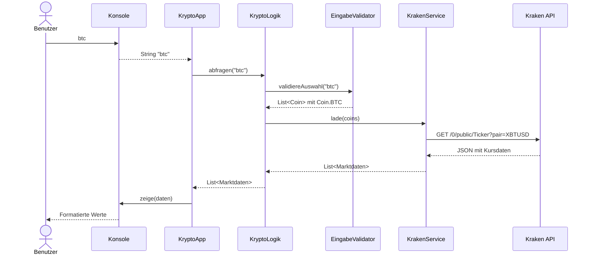

# KN-D3 – Krypto-Marktdaten mit Delegation

## Meine Applikationsidee

Ich entwickle eine Java-Konsolenapplikation, mit der ich Marktdaten von Bitcoin
(BTC), Solana (SOL) und Ethereum (ETH) abfragen kann. Ich wähle einen Coin oder
`ALLE` und sehe den letzten Handelskurs in USD, Hoch und Tief der letzten
24 Stunden sowie das Handelsvolumen in der jeweiligen Kryptowährung.
Die Daten stammen von der öffentlichen Kraken-API. Die App zeigt auch den
Abrufzeitpunkt an. Ungültige Eingaben führen zu einer eigenen Exception und
einer verständlichen Fehlermeldung. Anschliessend kann ich erneut auswählen.
Mit `0` beende ich die App.

Die Idee ist für die Besprechung mit der Lehrperson vorbereitet; die Besprechung
und Freigabe stehen noch aus.

## Starten

Voraussetzung: JDK 17 oder neuer (`java` und `javac` im PATH), PowerShell und Internet.
Im Hauptverzeichnis des Repositorys:

```powershell
.\src\KR\KN_D3\start.ps1
```

Das Skript lädt beim ersten Start **Gson 2.13.2** von Maven Central nach
`lib/`, kompiliert den Code nach `out/KN_D3` und startet die App. Gson liest das JSON-Format
der API. Die öffentlichen Abfragen benötigen keinen API-Schlüssel.

Beispielablauf: `btc` → Bitcoin-Daten, `ALLE` → alle drei Coins,
`DOGE` → eigene Fehlermeldung, `0` → beenden. Gross-/Kleinschreibung und
Leerzeichen vor oder nach dem Befehl werden toleriert.

Tests starten:

```powershell
.\src\KR\KN_D3\start.ps1 -Test
```

Nach dem ersten Bibliotheksdownload funktionieren die Tests ohne Internet.
Sie verwenden einen Ersatz-Service und einen lokalen HTTP-Testserver.
Für IntelliJ ist Gson bereits als Projektbibliothek konfiguriert. Nach einem
frischen Klonen einmal `.\src\KR\KN_D3\start.ps1 -SetupOnly` ausführen, um die
JAR herunterzuladen. Danach kann `Starter.main()` direkt gestartet werden.
Falls IntelliJ noch rote Imports anzeigt, das Projekt neu öffnen. Die JAR liegt
ausserhalb des Ausgabeordners, damit ein Rebuild sie nicht löscht; sie wird nicht
ins Git-Repository aufgenommen.

## Aufgabentrennung

| Klasse | Verantwortung |
|---|---|
| `Starter` | `main` startet ausschliesslich die Applikation. |
| `KryptoApp` | Verbindet die Objekte, steuert die Schleife und fängt Exceptions ab. |
| `Konsole` | Liest Benutzereingaben und formatiert die Ausgabe. |
| `EingabeValidator` | Prüft die Auswahl; wirft `UngueltigeEingabeException`. |
| `KryptoLogik` | Lässt zuerst validieren und beauftragt danach den Service. |
| `MarktdatenService` | Interface für das Laden von Marktdaten. |
| `KrakenService` | HTTP-Aufruf, JSON-Auswertung und Behandlung von API-Fehlern. |
| `Coin` / `Marktdaten` | Erlaubte Coins mit API-Kennung / unveränderliches Ergebnisobjekt. |
| `MarktdatenException` | Beschreibt Netzwerkfehler, API-Fehler und ungültige Antworten. |

## Antworten für die Besprechung

**Wo ist die Delegation?**

Delegation bedeutet, dass ein Objekt eine Aufgabe an ein anderes Objekt weitergibt.
`KryptoLogik` prüft die Eingabe nicht selbst und führt auch keinen HTTP-Aufruf aus:

```java
List<Coin> coins = validator.validiereAuswahl(eingabe);
return service.lade(coins);
```

Die Logik hält Referenzen auf ihre Helfer. Sie delegiert die Prüfung an
`EingabeValidator` und den Datenabruf über `MarktdatenService` an `KrakenService`.
Weil der Service über ein Interface eingebunden ist, kann der Test einen
Ersatz-Service einsetzen. Delegation erfolgt hier durch Methodenaufrufe auf
anderen Objekten, nicht durch Vererbung.

**Wie kommunizieren die Objekte? Welche Werte werden mitgegeben?**



**Wo werden Eingaben validiert und Exceptions geworfen?**

`EingabeValidator.validiereAuswahl()` erlaubt nur BTC, SOL, ETH und ALLE.
Bei leerem oder unbekanntem Input wirft er `UngueltigeEingabeException`.
Die Exception läuft durch `KryptoLogik` zurück zur `KryptoApp`, die sie auffängt
und die Meldung an `Konsole` weitergibt. Bei ungültigem Input wird die API
gar nicht aufgerufen. `0` und das Ende der Eingabe behandelt die App als Beenden.

**Wie sind User-Input, Logik und API getrennt?**

Nur `Konsole` verwendet Scanner und Textausgabe. `KryptoLogik` kennt weder
Scanner noch HTTP oder JSON. Nur `KrakenService` kennt den Endpoint und das
Antwortformat. Netzwerkprobleme, HTTP-Fehler (auch 429), API-Fehler und fehlende
Daten werden als `MarktdatenException` gemeldet; die Auswahl bleibt bedienbar.

## Daten und Grenzen

- Die Werte beziehen sich auf die USD-Handelspaare bei Kraken, nicht auf den gesamten Kryptomarkt.
- `c[0]` ist der letzte Handelskurs. `h[1]`, `l[1]` und `v[1]` beziehen sich auf die letzten 24 Stunden.
- Das Volumen wird in BTC, SOL bzw. ETH angezeigt, die Preise in USD.
- Der angezeigte Zeitpunkt ist der Abrufzeitpunkt, nicht der Zeitpunkt des letzten Handels.
- `ALLE` lädt die drei Handelspaare in einer Anfrage. Es gibt keine automatische Aktualisierung.
- Geld- und Mengenwerte werden als `BigDecimal` gespeichert. Daten bleiben nur während des Abrufs im Speicher.

Die Tests prüfen Validierung, Delegation mit übergebenen Werten, alle drei
API-Kennungen, die 24h-Felder, ungültiges JSON, fehlende Daten, API-/HTTP-Fehler,
Weiterlaufen nach Fehlern und Beenden.

## Weiterführende Quellen

- [Kraken: Ticker-API und Antwortformat](https://docs.kraken.com/api-reference/market-data/get-ticker-information)
- [Gson: JSON-Bibliothek für Java](https://github.com/google/gson)
- [Oracle: Eigene Exceptions erstellen](https://docs.oracle.com/javase/tutorial/essential/exceptions/creating.html)
- [Martin Fowler: Replace Inheritance with Delegation](https://refactoring.com/catalog/replaceInheritanceWithDelegation.html)

Mit KI-Unterstützung erstellt. Für die Besprechung kann ich den Ablauf einer
gültigen Eingabe und einer ungültigen Eingabe anhand der Klassen nachvollziehen.
