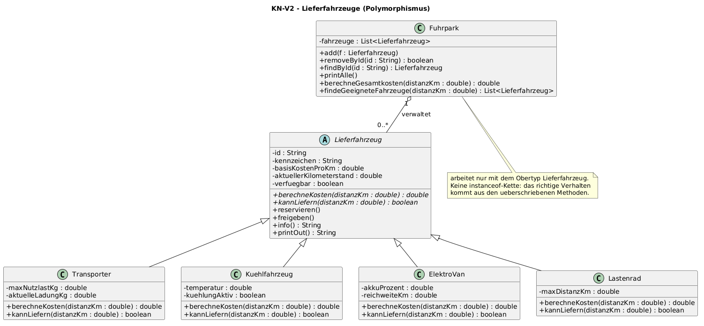

# KN-V2 – Lieferfahrzeuge verwalten (Polymorphismus)

Serie E · Modul 320 · Java

Eine Hierarchie von Lieferfahrzeugen. Kostenberechnung, Reichweitenprüfung und
Ausgabe laufen über **überschriebene Methoden**. Die Verwaltung (`Fuhrpark`)
arbeitet nur mit dem gemeinsamen Obertyp `Lieferfahrzeug` – ohne `instanceof`.

Der Code liegt unter [`code/`](code/), das Klassendiagramm unter
[`diagramm/klassendiagramm.puml`](diagramm/klassendiagramm.puml).

## Ausführen

Vom Repository-Hauptordner aus (Java 17 oder neuer):

```powershell
javac -encoding UTF-8 -d out-v2 (Get-ChildItem src/KR/KN_V2/code -Filter *.java).FullName
java -cp out-v2 KR.KN_V2.code.FuhrparkTest
java -cp out-v2 KR.KN_V2.code.Starter
```

`FuhrparkTest` prüft die polymorphen Methoden. `Starter` startet das Konsolenmenü.

## Klassendiagramm



## Die Klassen

**Abstrakte Oberklasse `Lieferfahrzeug`**
- Attribute: `id`, `kennzeichen`, `basisKostenProKm`, `aktuellerKilometerstand`, `verfuegbar`
- `berechneKosten()` und `kannLiefern()` sind **abstract** – jede Subklasse macht es anders.
- `reservieren()` / `freigeben()` werfen eine `IllegalStateException` bei ungültigem Zustand
  (z.B. zweimal reservieren).
- `info()` und `printOut()` für die Ausgabe.

**Subklassen** (jede überschreibt `berechneKosten` und `kannLiefern`):

| Klasse | Zusatzattribute | Kosten | Kann liefern, wenn |
|---|---|---|---|
| `Transporter` | `maxNutzlastKg`, `aktuelleLadungKg` | Basis × Distanz × Ladungsfaktor | Nutzlast nicht überschritten |
| `Kuehlfahrzeug` | `temperatur`, `kuehlungAktiv` | Basis × Distanz + Kühlzuschlag pro km | Kühlung aktiv und Temperatur ≤ 7° |
| `ElektroVan` | `akkuProzent`, `reichweiteKm` | Basis × Distanz × 0.6 (Strom) | vorhandene Reichweite ≥ Distanz |
| `Lastenrad` (Erweiterung) | `maxDistanzKm` | Basis × Distanz | Distanz ≤ maxDistanzKm |

**Verwaltung `Fuhrpark`** hält eine `List<Lieferfahrzeug>`:
`add`, `removeById`, `findById`, `printAlle`, `berechneGesamtkosten(distanzKm)`,
`findeGeeigneteFahrzeuge(distanzKm)`.

## Wie funktioniert der Polymorphismus?

`Fuhrpark` kennt nur den Obertyp `Lieferfahrzeug`. Beim Aufruf
`f.berechneKosten(distanz)` entscheidet **zur Laufzeit** das echte Objekt, welche
überschriebene Methode läuft – ein `Transporter` rechnet anders als ein
`ElektroVan`. Deshalb braucht es keine `instanceof`-Abfragen und keine
if-else-Ketten nach Typ.

```java
public List<Lieferfahrzeug> findeGeeigneteFahrzeuge(double distanzKm) {
    List<Lieferfahrzeug> treffer = new ArrayList<>();
    for (Lieferfahrzeug f : fahrzeuge) {
        if (f.kannLiefern(distanzKm)) {
            treffer.add(f);
        }
    }
    return treffer;
}
```

## Erweiterbarkeit

`Lastenrad` wurde als vierte Fahrzeugklasse ergänzt, **ohne** eine Zeile in
`Fuhrpark` zu ändern. Eine neue Klasse muss nur von `Lieferfahrzeug` erben und die
zwei abstrakten Methoden überschreiben – die Verwaltung funktioniert sofort mit.

## Konsolenmenü (Task)

```text
1 = Fahrzeug hinzufuegen
2 = Alle Fahrzeuge anzeigen
3 = Fahrzeug suchen
4 = Geeignete Fahrzeuge fuer eine Distanz anzeigen
5 = Lieferkosten fuer ein Fahrzeug berechnen
6 = Fahrzeug reservieren / freigeben
7 = Gesamtkosten aller geeigneten Fahrzeuge vergleichen
8 = Fahrzeug loeschen
9 = Beenden
```

Beim Start werden Beispielfahrzeuge geladen (je zwei pro Verbrenner-Subklasse und
ElektroVan, plus ein Lastenrad).

## Dateien

```text
KN_V2/
├── README.md
├── code/
│   ├── Lieferfahrzeug.java
│   ├── Transporter.java
│   ├── Kuehlfahrzeug.java
│   ├── ElektroVan.java
│   ├── Lastenrad.java
│   ├── Fuhrpark.java
│   ├── Starter.java
│   └── FuhrparkTest.java
└── diagramm/
    └── klassendiagramm.puml / .png / .svg
```
