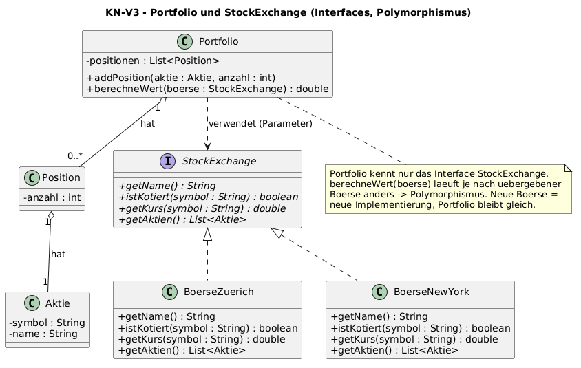

# KN-V3 – Interfaces flexibel und polymorph nutzen

Modul 320 · Java

Gewählte Idee: **Portfolio von Aktien mit dem Interface `StockExchange`.**

Ein `Portfolio` berechnet seinen Wert über eine Börse. Es kennt aber nur das
**Interface** `StockExchange`, nicht die konkrete Börse. Die Börse wird als
Parameter übergeben – dahinter „verstecken" sich verschiedene Börsenplätze
(Zürich, New York). Dadurch ist der Code flexibel und polymorph.

Code unter [`code/`](code/), Klassendiagramm unter
[`diagramm/klassendiagramm.puml`](diagramm/klassendiagramm.puml).

## Ausführen

Vom Repository-Hauptordner aus (Java 17 oder neuer):

```powershell
javac -encoding UTF-8 -d out-v3 (Get-ChildItem src/KR/KN_V3/code -Filter *.java).FullName
java -cp out-v3 KR.KN_V3.code.PortfolioTest
java -cp out-v3 KR.KN_V3.code.Starter
```

`PortfolioTest` prüft, dass derselbe Portfolio-Wert je nach Börse anders ist.
`Starter` startet das Konsolenmenü.

## Klassendiagramm



## Die Klassen

| Klasse | Aufgabe |
|---|---|
| `Aktie` | ein Wertpapier mit `symbol` und `name` |
| `Position` | eine Aktie + Anzahl im Portfolio |
| `Portfolio` | Liste von Positionen; `berechneWert(StockExchange)` |
| `StockExchange` **(Interface)** | Vertrag: `getKurs`, `istKotiert`, `getName`, `getAktien` |
| `BoerseZuerich`, `BoerseNewYork` | konkrete Börsen mit eigenen kotierten Aktien und Kursen |
| `Starter` | Konsolenmenü |

## Warum Interface = flexibel + polymorph?

`Portfolio.berechneWert` bekommt eine `StockExchange` übergeben und ruft darauf
`getKurs(...)` auf. **Welche** Börse das ist, weiss das Portfolio nicht:

```java
public double berechneWert(StockExchange boerse) {
    double summe = 0.0;
    for (Position p : positionen) {
        if (boerse.istKotiert(p.getAktie().getSymbol())) {
            summe += p.getAnzahl() * boerse.getKurs(p.getAktie().getSymbol());
        }
    }
    return summe;
}
```

- **Polymorph:** Zur Laufzeit läuft die Methode der echten Börse. Dasselbe
  Portfolio hat an der Börse Zürich einen anderen Wert als an der Börse New York.
- **Flexibel:** Eine neue Börse (z.B. London) ist nur eine weitere Klasse, die
  `StockExchange` implementiert. Am `Portfolio` muss **nichts** geändert werden.

Beispiel aus dem Testlauf mit demselben Portfolio:

| Börse | Portfoliowert | kotierte Positionen |
|---|---|---|
| Zürich | 1949.00 | Nestlé, ABB |
| New York | 3928.00 | Apple, Tesla |

## Konsolenmenü

```text
1 = Boerse waehlen
2 = Portfoliowert anzeigen
3 = Aktienkurs abfragen
4 = Portfolio anzeigen
5 = Beenden
```

## Dateien

```text
KN_V3/
├── README.md
├── code/
│   ├── Aktie.java
│   ├── Position.java
│   ├── StockExchange.java
│   ├── BoerseZuerich.java
│   ├── BoerseNewYork.java
│   ├── Portfolio.java
│   ├── Starter.java
│   └── PortfolioTest.java
└── diagramm/
    └── klassendiagramm.puml / .png / .svg
```
