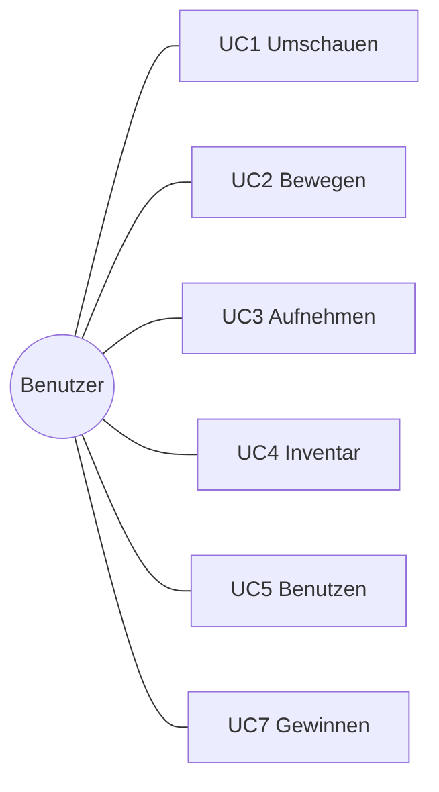
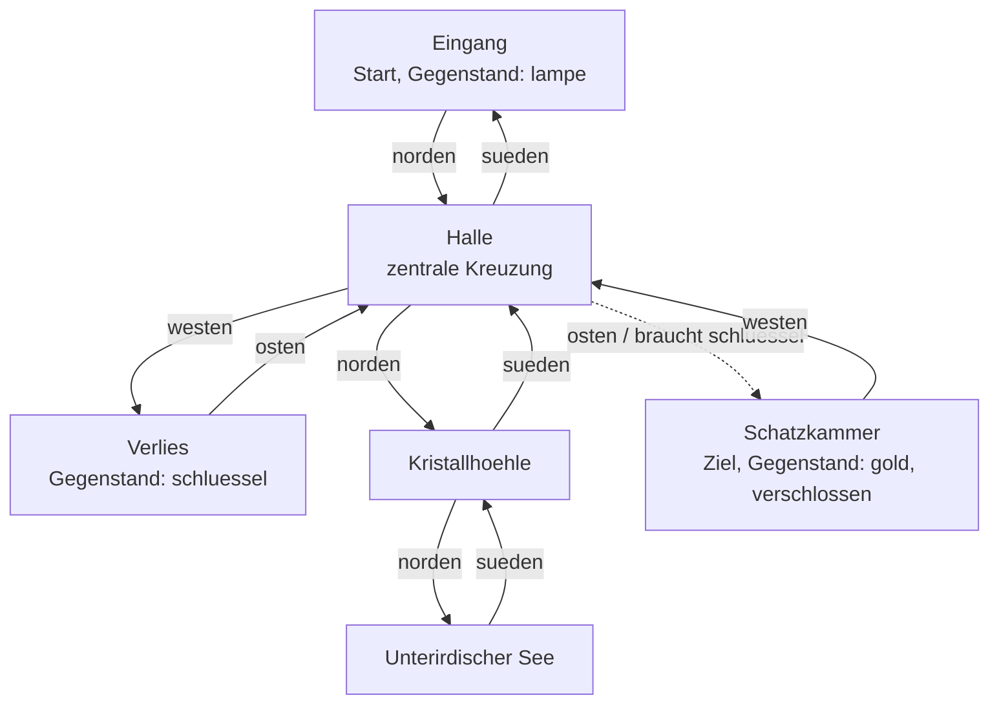
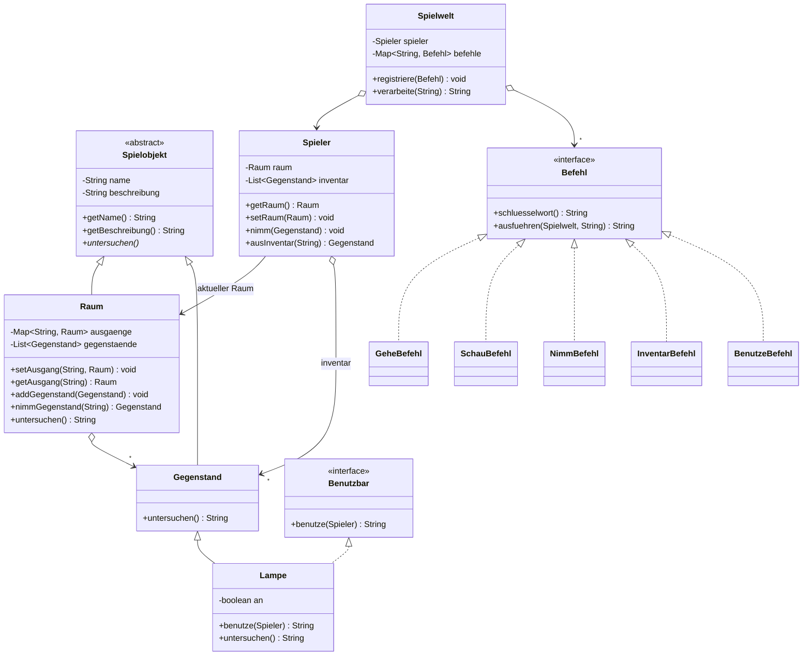
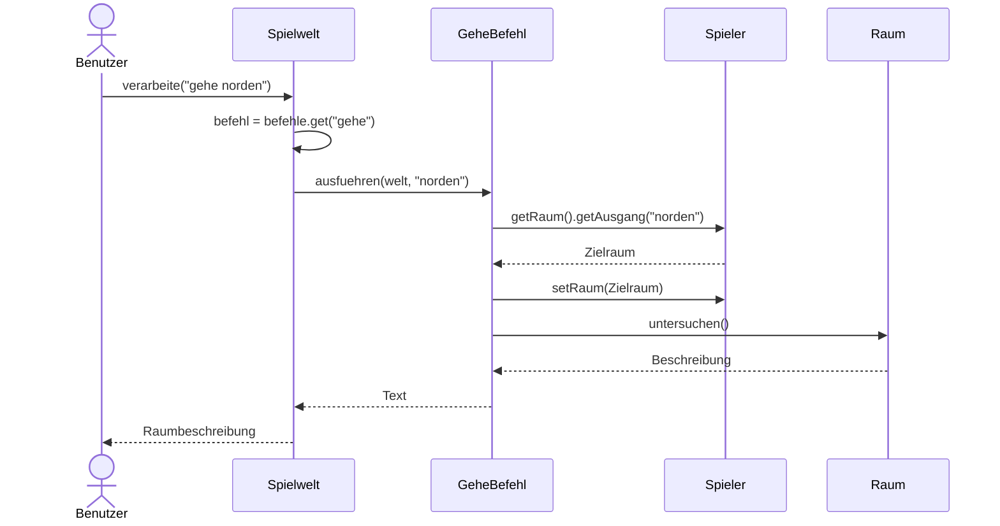

# KN-M4 (Nico) – Projektskizze Text-Adventure

Modul 320 · Niveau 4 · eigene Aufgabenstellung von Nico (ZH-NICO)

> **Kompetenz M4:** Für meine eigene Aufgabenstellung bilde ich Abstraktionen
> (Interfaces, abstrakte Klassen) mit den nötigen UML-Artefakten ab und erstelle
> sinnvolle UML-Diagramme. Dieses Dokument ist die **Planung / Skizze** der
> grösseren Arbeit. Die Umsetzung (Code) folgt in D4, V4 und Q4.

---

## 1. Beschreibung der Applikation

Ein **textbasiertes Adventure-Game** im Stil von *Zork*. Der Spieler bewegt sich
über Texteingaben durch eine Höhle, schaut sich um, sammelt Gegenstände, benutzt
sie und versucht, den Schatz zu finden. Die Welt besteht aus **Räumen**, die über
Himmelsrichtungen verbunden sind. Eingaben wie `gehe norden` oder `nimm lampe`
werden von einem einfachen Textparser verarbeitet.

Das Spiel läuft komplett in der **Konsole**, braucht kein Internet und keine
externe Bibliothek.

### Ziel (Muss-Kriterien)

| # | Muss-Kriterium |
|---|---|
| M1 | Mehrere Räume mit Beschreibung, verbunden über benannte Ausgänge (norden, sueden, osten, westen) |
| M2 | Spieler kann sich bewegen (`gehe <richtung>`) |
| M3 | Spieler kann sich umschauen (`schau`) und sieht Beschreibung, Gegenstände und Ausgänge |
| M4 | Räume enthalten Gegenstände; aufnehmen (`nimm <ding>`) und Inventar ansehen (`inventar`) |
| M5 | Gegenstände benutzen (`benutze <ding>`), z.B. Lampe ein-/ausschalten |
| M6 | Unbekannte oder leere Eingaben werden sauber gemeldet (kein Absturz) |
| M7 | Es gibt ein Spielziel (Schatzkammer erreichen / Schatz nehmen) |

### Nice-to-have

- Verschlossene Türen, die einen **Schlüssel** benötigen (Rätsel).
- **Dunkelheit:** ohne brennende Lampe sieht man den Raum nicht.
- Gegenstände wieder **ablegen** (`lege ab <ding>`).
- **Gegner** und einfaches Kampfsystem mit Lebenspunkten.
- **Speichern / Laden** des Spielstands in eine Datei.
- Mehr Befehle: `oeffne`, `rede`, `hilfe`.
- Farbige Konsolenausgabe oder eine kleine ASCII-Karte.

---

## 2. Anforderungen

### Funktionale Anforderungen

- Der Parser zerlegt die Eingabe in **Befehlswort** + **Argument**.
- Jeder Befehl ist eine eigene Klasse hinter dem Interface `Befehl` und kann
  ohne Änderung der Kernlogik ergänzt werden (offen für Erweiterung).
- Jedes Ding in der Welt (Raum, Gegenstand) ist ein `Spielobjekt` und kann
  `untersuchen()` beantworten (Polymorphie).
- Benutzbare Gegenstände setzen das Interface `Benutzbar` um.

### Nicht-funktionale Anforderungen

- Java 17 oder neuer, keine externe Bibliothek, keine Netzwerkverbindung.
- Einfacher, lesbarer Code ohne Kommentare.
- Erweiterbar: neue Räume, Gegenstände und Befehle sollen leicht hinzufügbar sein.

---

## 3. Use Cases

Was kann der Benutzer mit der Applikation machen:

| ID | Use Case | Eingabe | Ergebnis |
|---|---|---|---|
| UC1 | Umschauen | `schau` | Beschreibung, Gegenstände und Ausgänge des Raums |
| UC2 | Bewegen | `gehe norden` | Spieler wechselt in den Nachbarraum |
| UC3 | Gegenstand aufnehmen | `nimm lampe` | Gegenstand wandert in das Inventar |
| UC4 | Inventar ansehen | `inventar` | Liste der getragenen Gegenstände |
| UC5 | Gegenstand benutzen | `benutze lampe` | Wirkung des Gegenstands (Lampe an/aus) |
| UC6 | Falsche Eingabe | `tanze` | verständliche Fehlermeldung, kein Absturz |
| UC7 | Spiel gewinnen | `nimm gold` in der Schatzkammer | Spielziel erreicht |



---

## 4. Spielkarte (geplanter Raumplan)

So soll die Welt aufgebaut sein: sechs Räume, verbunden über Himmelsrichtungen.
Die Höhle beginnt beim `Eingang` (dort liegt die `lampe`). Die `Halle` ist die
zentrale Kreuzung. Im `Verlies` liegt der `schluessel`, der die verschlossene
`Schatzkammer` öffnet – dort wartet das `gold` als Spielziel.



> Gestrichelte Verbindung = verschlossene Tür (Nice-to-have: Rätsel mit Schlüssel).
> Jeder Pfeil ist ein Ausgang in eine Himmelsrichtung; die Rückrichtung ist
> jeweils eingezeichnet. Quelle als PlantUML: [`karte.puml`](karte.puml)

---

## 5. Architektur-Skizze (UML-Klassendiagramm)

Die geplante Architektur nutzt eine **abstrakte Klasse** (`Spielobjekt`) und zwei
**Interfaces** (`Befehl`, `Benutzbar`).



**UML-Artefakte und Begründung:**

- **Abstrakte Klasse `Spielobjekt`** – gemeinsamer Zustand (`name`, `beschreibung`)
  für alle Dinge in der Welt; erzwingt die Methode `untersuchen()`. Man kann kein
  `new Spielobjekt(...)` erzeugen.
- **Vererbung** (`<|--`): `Raum` und `Gegenstand` sind `Spielobjekt`e, `Lampe` ist
  ein spezieller `Gegenstand`.
- **Interface `Befehl`** – ein Vertrag für alle Spielbefehle. Jeder Befehl ist eine
  eigene Klasse. Neue Befehle werden hinzugefügt, ohne die `Spielwelt` zu ändern.
- **Interface `Benutzbar`** – nur Gegenstände, die man benutzen kann (z.B. `Lampe`),
  setzen es um.
- **Realisierung** (`<|..`): die Befehl- und die Lampen-Klasse setzen die Interfaces um.
- **Aggregation** (`o-->`): die `Spielwelt` verwaltet Befehle, der `Spieler` trägt
  Gegenstände, ein `Raum` enthält Gegenstände.

> Quelle als PlantUML: [`klassendiagramm.puml`](klassendiagramm.puml)

---

## 6. Sequenzdiagramm – typischer Use Case (UC2 Bewegen)

Ablauf, wenn der Benutzer `gehe norden` eingibt:



> Quelle als PlantUML: [`sequenzdiagramm.puml`](sequenzdiagramm.puml)

---

## 7. Dokumentation der KI-Schritte (Prompts)

Die Architektur und die Diagramme wurden mit Unterstützung einer KI (Claude)
erstellt. Verwendete Prompts in der Reihenfolge:

1. **Idee / Architektur**
   > „Ich möchte ein textbasiertes Adventure-Game wie Zork in Java bauen. Entwirf
   > die Architektur mit einer abstrakten Klasse und Interfaces. Liste die Klassen
   > mit ihrer Verantwortlichkeit auf. Der Code soll einfach und ohne Kommentare sein."

2. **Klassendiagramm generieren**
   > „Erstelle aus dieser Architektur ein UML-Klassendiagramm als Mermaid. Zeige die
   > abstrakte Klasse, die Interfaces, Vererbung, Realisierung und Aggregation mit
   > den wichtigsten Attributen und Methoden."

3. **Use Cases und Anforderungen**
   > „Liste die Use Cases auf (was kann der Benutzer tun) und trenne Muss-Kriterien
   > von Nice-to-have."

4. **Sequenzdiagramm generieren**
   > „Erstelle ein Sequenzdiagramm (Mermaid) für den Use Case ‚Spieler bewegt sich
   > in einen anderen Raum' beim Befehl `gehe norden`."

5. **Spielkarte / Raumplan generieren**
   > „Zeichne die geplante Spielwelt als Raumplan: welche Räume gibt es und wie sind
   > sie über Himmelsrichtungen verbunden? Markiere Startraum, Ziel und wo welche
   > Gegenstände liegen. Verschlossene Türen gestrichelt."

6. **Prüfen / Anpassen**
   > „Prüfe, ob Klassen- und Sequenzdiagramm zueinander passen, und korrigiere die
   > Methodennamen so, dass sie identisch sind."

**Bewertung der KI-Ausgabe:** Die Diagramme waren grösstenteils brauchbar. Angepasst
wurden die Methodennamen (einheitlich zwischen beiden Diagrammen) sowie die
Richtung der Aggregations-Pfeile. Die KI dient als Werkzeug für die Skizze – die
Entscheidungen über Abstraktionen und Struktur stammen von mir.

---

## 8. Dateien

```text
N4_nico/M4/
├── README.md              (dieses Dokument)
├── klassendiagramm.puml   (UML-Klassendiagramm als PlantUML)
├── sequenzdiagramm.puml   (UML-Sequenzdiagramm als PlantUML)
└── karte.puml             (Spielkarte / Raumplan als PlantUML)
```
