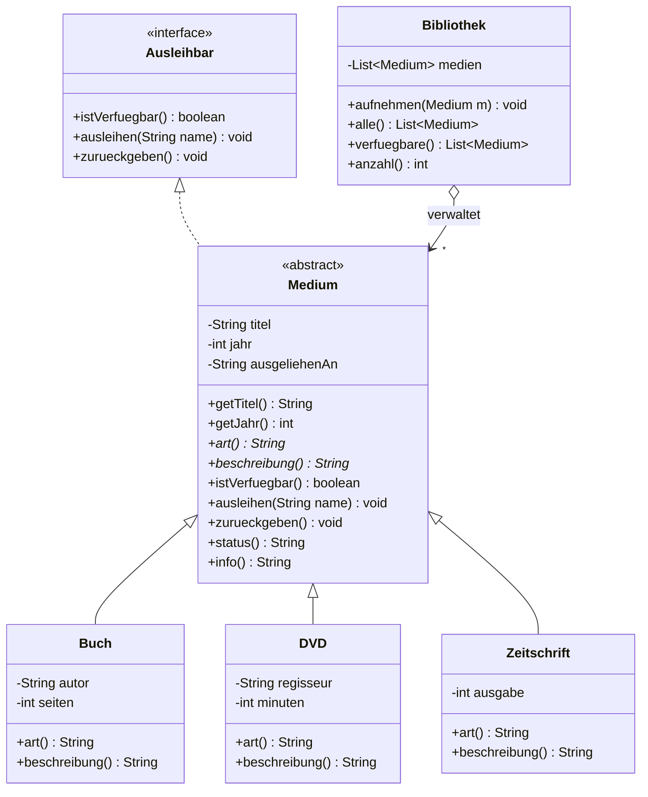

# KN-M4 (Nico) – Abstraktionen und UML

Modul 320 · Niveau 4 · Java · eigene Aufgabenstellung von Nico (ZH-NICO)

## Kompetenz

> Für meine eigene Aufgabenstellung bilde ich **Abstraktionen (Interface und
> abstrakte Klasse)** ab und stelle sie in einem **UML-Klassendiagramm** dar.

## Eigene Aufgabenstellung

Eine kleine **Medienverwaltung** für eine Bibliothek. Es gibt verschiedene
Medien (Buch, DVD, Zeitschrift). Alle Medien kann man **ausleihen** und
**zurückgeben**. Jedes Medium liefert seine eigene Art und Beschreibung. Die
`Bibliothek` verwaltet alle Medien und kann die noch verfügbaren anzeigen.

## Die zwei Abstraktionen

| Abstraktion | Klasse | Zweck |
|---|---|---|
| **Interface** | `Ausleihbar` | Vertrag: was kann ausgeliehen werden (`istVerfuegbar`, `ausleihen`, `zurueckgeben`) |
| **Abstrakte Klasse** | `Medium` | gemeinsamer Zustand + gemeinsames Verhalten; zwingt Unterklassen zu `art()` und `beschreibung()` |

- `Ausleihbar` ist nur ein **Vertrag**, keine Umsetzung. Jede Klasse, die das
  Verleihen beherrscht, kann es umsetzen.
- `Medium` ist **abstrakt**: man kann kein `new Medium(...)` machen. Die Klasse
  hält `titel`, `jahr`, `ausgeliehenAn` und die fertige Verleih-Logik, lässt
  aber `art()` und `beschreibung()` offen (`abstract`). Diese werden erst in
  `Buch`, `DVD`, `Zeitschrift` konkret.

## UML-Klassendiagramm



**UML-Artefakte im Diagramm:**

- `<<interface>>` = Interface `Ausleihbar`.
- *kursiv / `<<abstract>>`* = abstrakte Klasse `Medium`; `art()*` und
  `beschreibung()*` sind die abstrakten Methoden.
- gestrichelter Pfeil mit Dreieck (`<|..`) = **Realisierung** (Medium setzt
  Ausleihbar um).
- durchgezogener Pfeil mit Dreieck (`<|--`) = **Vererbung** (Buch/DVD/Zeitschrift
  erben von Medium).
- Raute (`o-->`) = **Aggregation** (Bibliothek verwaltet mehrere Medien).

> Dieselbe Darstellung liegt als PlantUML-Quelle in [`uml.puml`](uml.puml).

## Ausführen

Vom Repository-Hauptordner aus (Java 17 oder neuer):

```powershell
javac -encoding UTF-8 -d out-m4 (Get-ChildItem src/KR/N4_nico/M4/code -Filter *.java).FullName
java -cp out-m4 KR.N4_nico.M4.code.MedienTest
java -cp out-m4 KR.N4_nico.M4.code.Starter
```

## Klassen

| Klasse | Rolle |
|---|---|
| `Ausleihbar` **(Interface)** | Vertrag fürs Ausleihen |
| `Medium` **(abstrakt)** | gemeinsamer Zustand + Verleih-Logik, offene `art()`/`beschreibung()` |
| `Buch`, `DVD`, `Zeitschrift` | konkrete Medien |
| `Bibliothek` | verwaltet die Medien (Aggregation) |
| `Starter` | `main`, zeigt das Programm |
| `MedienTest` | einfache Tests ohne JUnit |

## Ausgabe von Starter

```text
=== Alle Medien ===
Buch: Clean Code (2008) - von Robert C. Martin, 464 Seiten [verfuegbar]
DVD: Inception (2010) - Regie Christopher Nolan, 148 Min [verfuegbar]
Zeitschrift: CHIP (2026) - Ausgabe Nr. 11 [verfuegbar]

Leihe 'Clean Code' an Nico aus...

=== Verfuegbar ===
DVD: Inception (2010) - Regie Christopher Nolan, 148 Min [verfuegbar]
Zeitschrift: CHIP (2026) - Ausgabe Nr. 11 [verfuegbar]
```
